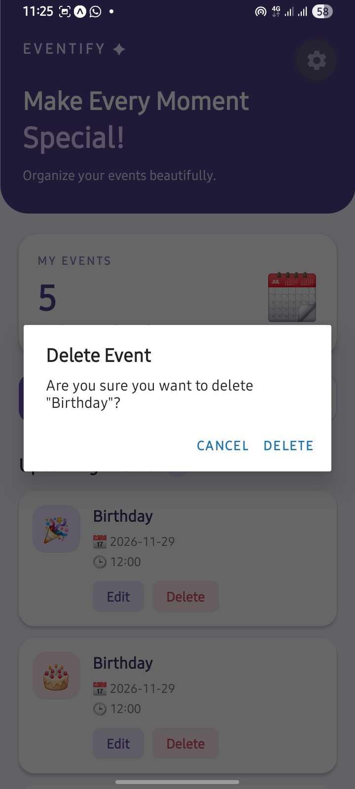
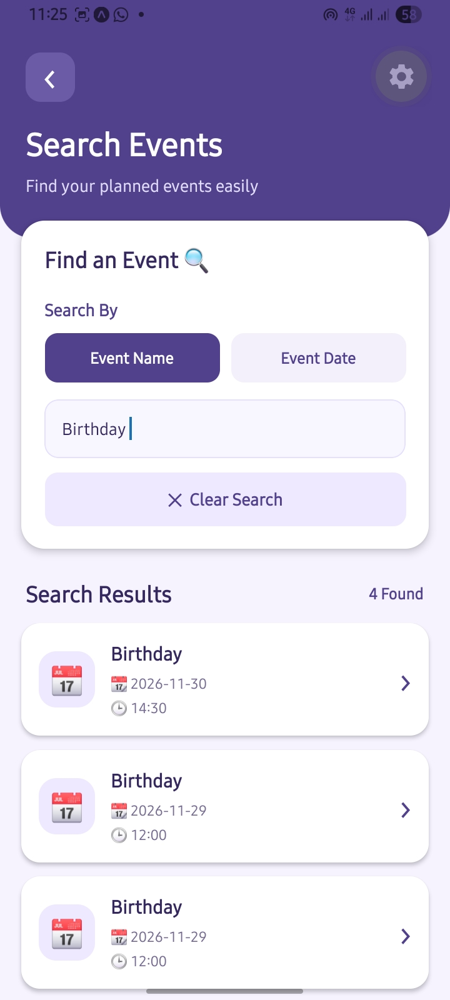

# Event Planner App

## Student Details

- **Name:** Sanuja Limoshini
- **Index Number:** JF/ICT/25/24
- **Module:** Mobile Application Development
- **Module Code:** K72T001M15
- **Project Type:** Individual Self-Study Project

---

## 1. Introduction

The Event Planner App is a mobile application developed using React Native and Expo. This application helps users create, organize, manage, and search their personal events.

Users can add event details, view upcoming and past events, edit or delete events, and receive notification reminders before their events.

The application provides a simple and user-friendly interface.

## 2. Project Objectives

- To develop a mobile application for managing events.
- To allow users to create and organize events.
- To provide event editing and deleting facilities.
- To help users search for events easily.
- To send reminders through local notifications.
- To store event information on the device.

## 3. Features Implemented

### 3.1 Create Events
- Add new events.
- Enter event name, date, time, and description.
- Set reminders for events.
- Validate user inputs before saving.

### 3.2 View Events
- Display upcoming events.
- Sort upcoming events by date and time.
- Separate past events from upcoming events.
- View complete event details.

### 3.3 Edit Events
- Update existing event information.
- Modify event name, date, time, and description.

### 3.4 Delete Events
- Delete unwanted events.
- Display a confirmation message before deleting.

### 3.5 Search Events
- Search events by event name.
- Search events by event date.
- Display matching search results.

### 3.6 Notification Reminders
- Set reminders for events.
- Request notification permission.
- Receive local notifications for scheduled events.

### 3.7 Data Storage
- Use AsyncStorage to save event information.
- Keep saved events available after closing and reopening the application.

## 4. Technologies and Tools Used

- React Native
- JavaScript
- Expo
- Expo Go
- Visual Studio Code
- AsyncStorage
- Expo Notifications
- Node.js and npm
- Git and GitHub

## 5. Software Requirements

- Windows operating system
- Node.js and npm
- Visual Studio Code
- Android smartphone
- Expo Go mobile application
- Internet connection for development and initial setup

## 6. Project Folder Structure

```text
EventPlannerApp/
│
├── screenshots/
│   ├── add-event.jpeg
│   ├── Delete.jpeg
│   ├── home.jpeg
│   ├── search.jpeg
│   └── update.jpeg
│
├── src/
│   ├── components/
│   │   └── Eventcard.js
│   │
│   ├── screens/
│   │
│   └── utils/
│       ├── notifications.js
│       └── storage.js
│
├── .gitignore
├── App.js
├── app.json
├── index.js
├── package.json
├── package-lock.json
└── README.md
```

## 7. How to Install and Run the Application

### Step 1: Clone the GitHub Repository

```bash
git clone https://github.com/Sanujalimoshin/EventPlannerApp.git
```

### Step 2: Open the Project Folder

```bash
cd EventPlannerApp
```

### Step 3: Install Dependencies

```bash
npm install
```

### Step 4: Start the Expo Development Server

```bash
npx expo start --go
```

### Step 5: Run on Android

1. Install Expo Go on an Android smartphone.
2. Connect the phone and computer to the same Wi-Fi network.
3. Scan the QR code displayed in the terminal.
4. Open the application using Expo Go.

## 8. Data Storage and Notification System

The application uses AsyncStorage to store event information locally on the device.

Expo Notifications is used to schedule local notification reminders. Users can set reminders for their events and receive notifications at the scheduled time.

## ## 9. Testing

The following application functions were tested successfully:

- Creating new events.
- Validating event input fields.
- Viewing upcoming and past events.
- Editing existing events.
- Deleting events with confirmation.
- Searching events by name and date.
- Scheduling and receiving notification reminders.
- Saving and loading events using AsyncStorage.
- Checking empty states and invalid input handling.
- Testing the application on an Android phone using Expo Go.

All the main application features were tested to ensure that they work correctly.

## 10. Application Screenshots

### 10.1 Home Screen


### 10.2 Add Event Screen


### 10.3 Update Event Screen


### 10.4 Delete Event Screen



### 10.5 Search Screen



## 11. Conclusion

The Event Planner App was developed to help users manage their personal events easily. It provides important features such as event creation, viewing, editing, deleting, searching, and notification reminders.

This project helped to improve my practical knowledge and skills in React Native, JavaScript, Expo, mobile application development, and GitHub.

---

**Developed by:** Sanuja Limoshini  
**Index Number:** JF/ICT/25/24  
**Module:** Mobile Application Development (K72T001M15)